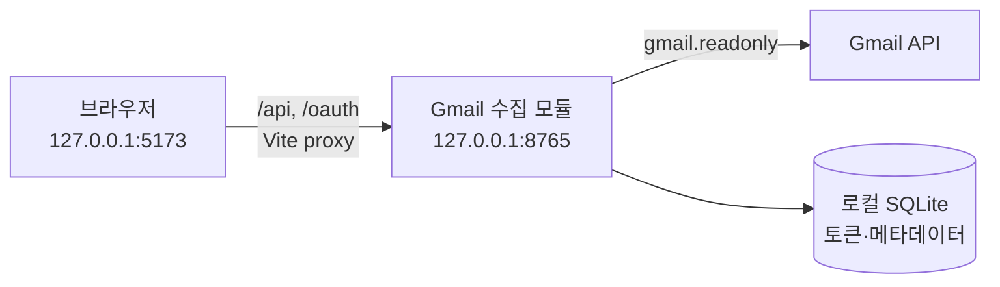
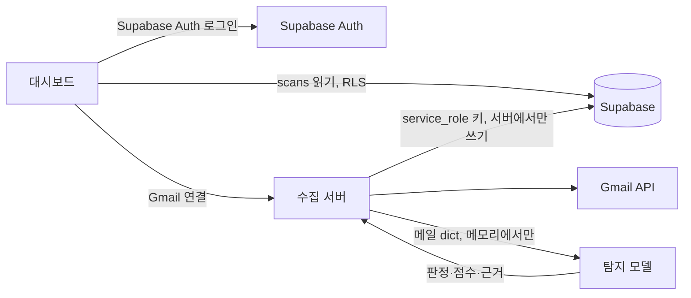

# 모듈 연동 구조와 진행 단계

Gmail 수집(심재훈), 탐지 모델(윤주혁), 문맥 분석(박한빈·이지훈), Supabase 저장(김서진), 대시보드(이지훈)를 한 페이지로 묶는 작업의 기준 문서다. 2026-10-29 `develop`(`a831af3`) 기준이다.

## 지금 연결된 것

| 구간 | 상태 | 코드 |
| --- | --- | --- |
| 대시보드 → Gmail 수집 모듈 | 연결됨 (#11, PR #16) | `src/dashboard/vite.config.js`, `src/dashboard/src/api.js` |
| Gmail OAuth (실제 계정) | 연결됨. OAuth 앱이 테스트 모드라 등록한 테스트 사용자만 로그인 | `src/gmail/src/prodog_gmail/google.py` |
| Gmail 수집 → 탐지 모델 | 연결됨 (#29, PR #30) | `src/gmail/src/prodog_gmail/scan.py` |
| 수집·탐지 결과 → Supabase | 어댑터 구현 (#13, PR #32). 테스트 사용자 1명 고정 | `src/gmail/src/prodog_gmail/supabase.py` |
| Supabase → 대시보드 | 미연결 (#14, #38) | 없음 |
| 로그인 (Supabase Auth) | 미연결. 로그인 버튼은 Gmail OAuth 시작에 연결됨(#18) | `src/dashboard/src/Login.jsx` |

대시보드는 Supabase 대신 Gmail 수집 모듈을 직접 읽는다. 탐지 결과가 없어서 모든 메일이 `검사 전` 상태로 보인다.

## 현재 흐름



- 대시보드는 `GET /api/mails?limit=20`으로 받은편지함 메타데이터를 받는다. 본문은 브라우저로 오지 않는다.
- Google 동의가 끝나면 수집 모듈이 `DASHBOARD_URL/?connected=1`로 돌려보낸다.
- 수집 모듈은 Host와 Origin이 `APP_BASE_URL`과 같아야 요청을 받는다. Vite proxy가 이 dev 서버에서 온 요청만 Origin을 바꿔 넘긴다.

## 목표 흐름



- 브라우저는 Supabase를 anon 키로 읽기만 한다. 쓰기는 서버만 한다.
- 메일 본문(`raw`, `text_plain`, `text_html`, `analysis_text`)은 Supabase에 저장하지 않는다. 저장 규칙은 [SUPABASE_TABLE.md](SUPABASE_TABLE.md)를 따른다.

## 단계

| 순서 | 이슈 | 담당 | 내용 | 선행 |
| --- | --- | --- | --- | --- |
| 1 | #11 (완료) | 심재훈 | 대시보드에서 Gmail 수집 모듈 호출 | 없음 |
| 2 | #12 (닫힘, SQL 미반영은 #37) | 김서진 | `scans`를 테이블로 둘지 뷰로 둘지 정하고 적용 SQL 커밋 | 없음 |
| 3 | #29 (완료) | 심재훈 | 수집 모듈에서 탐지 모델 호출, 결과를 대시보드 행 모양으로 변환 | PR #10 머지됨 |
| 4 | #13 (완료) | 심재훈 | 수집·탐지 결과를 Supabase `mail_messages`, `analysis_results`에 저장 | 2, 3 |
| 5 | #14, #38 | 이지훈 | 대시보드가 Supabase `scans`를 읽도록 교체 | 2, 4 |
| 6 | #37, #34 | 김서진·심재훈 | Supabase Auth 로그인과 Gmail 연결을 같은 `user_id`에 묶기 | 4 |

## 정해야 할 것

1. **`scans`의 형태.** `src/dashboard/schema.sql`은 테이블로, `arch/SUPABASE_TABLE.md`는 뷰로 정의한다. 문서가 링크한 `supabase-gmail-schema.sql`은 레포에 없다. (#12)
2. **로컬 LLM 단계.** 박한빈·이지훈이 `qwen3.5:9b`, `Foundation-Sec-8B`, Jev 중 무엇을 `llm_score`에 쓸지, ML 모델 뒤 2차 판단으로 붙일지 정한다. (#5 완료, #36)
3. **서버 코드 위치.** 3~4단계를 `src/gmail`에 계속 붙일지, 수집·탐지·저장을 조율하는 `src/server`를 새로 만들지 정한다. 처음에는 `src/gmail`에 붙이고, 파일이 커지거나 담당자가 갈리면 나누는 순서를 제안한다.

## 확정한 점수 계약

- `static_score = round(prompt_injection_probability * 100)`이다. 표시용 백분율이며 판정을 다시 계산하지 않는다.
- 실제 `verdict`는 각 탐지 모델의 임계값으로 정한다.
- 병렬 탐지에서는 최종 판정을 만든 모델의 점수를 쓰고, 같은 판정이면 더 높은 점수를 쓴다.
- R01~R07은 대시보드 데모에서 근거만 찾으며 `static_score`와 실제 판정에는 사용하지 않는다.

## 로컬 실행

```powershell
# 1. 수집 모듈 (src/gmail)
uv run python scripts/setup_local.py          # .env 처음 만들 때만
uv run python scripts/configure_google.py 'C:\경로\client_secret.json'
# .env: APP_MODE=google, DASHBOARD_URL=http://127.0.0.1:5173
uv run uvicorn prodog_gmail.app:app --host 127.0.0.1 --port 8765 --no-access-log

# 2. 대시보드 (src/dashboard)
npm install
npm run dev
```

브라우저 주소는 `http://127.0.0.1:5173`이다. `localhost`로 열면 세션 쿠키와 Origin이 맞지 않아 연결이 `csrf_failed`로 막힌다. Google 클라이언트 정보 없이 화면만 보려면 `.env`를 `APP_MODE=demo`로 둔다.

## 관련 문서

- [SUPABASE_TABLE.md](SUPABASE_TABLE.md): Supabase 테이블과 `scans` 읽기 계약
- [src/gmail/docs/integration.md](../src/gmail/docs/integration.md): 수집 모듈 API 계약과 Supabase 이전 시 할 일
- [src/gmail/docs/collect-api-contract.md](../src/gmail/docs/collect-api-contract.md): 수집 출력 필드와 저장 정책
- [src/detector/README.md](../src/detector/README.md): 탐지 모델 입력·출력
