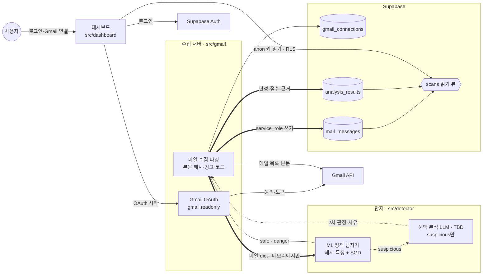

# ProDog 목표 아키텍처

## 주제

Gmail을 OAuth로 연동해 받은편지함의 메일에 숨은 프롬프트 인젝션을 찾아 알려 주는 웹앱
## 목표

AI 비서나 LLM 요약 기능에 메일을 읽히는 사용자가, 메일 속에 숨은 지시문이 자기 AI를 조종하기 전에 위험한 메일을 알아보도록 돕는다.

이 문서는 서비스의 목표 구조와 현재 구현 상태를 구분해 기록한다. 지금 동작하는 부분은 Gmail 수집, 대시보드의 메일 목록, ML 정적 탐지기, 수집 서버의 탐지기 호출과 Supabase 쓰기 어댑터이며, 대시보드가 Supabase를 읽는 구간과 사용자 로그인 귀속은 아직 구현 전이다. **현재 우선 범위는 정적 탐지기가 내는 `safe`, `suspicious`, `danger` 3단계 판정을 대시보드에 보이는 것까지**이다.

## 범위

- 사용자가 Google 계정을 연결하면 받은편지함 메일을 읽기 전용으로 수집한다.
- 메일의 제목, 발신자, 본문(plain·HTML), 첨부 메타데이터에서 간접 프롬프트 인젝션 확률을 계산한다.
- 확률을 `safe`(정상), `suspicious`(의심), `danger`(위험)로 나누고 판정 근거를 붙인다.
- 의심 메일은 문맥 분석(LLM 2차 판단)으로 넘긴다. 구현 방식은 정하지 않았다.
- 대시보드에서 메일별 판정, 점수, 근거, 수집이 불완전했던 부분을 보여 준다.

## 설계 원칙

- Gmail 권한은 `gmail.readonly`만 쓴다. 메일을 보내거나 지우거나 옮기지 않는다.
- 메일 본문은 브라우저로 보내지 않고 Supabase에도 저장하지 않는다. 본문은 수집 서버와 탐지 모델 사이에서 메모리로만 오간다. 저장하는 것은 판정, 점수, 제한된 근거 발췌다.
- 탐지기는 최종 악성 판정을 하지 않는다. 확실한 정상만 `safe`로 통과시키고, 애매한 메일은 `suspicious`로 다음 단계에 넘긴다.
- HTML은 실행하거나 외부 리소스를 불러오지 않고 문자열로만 분석한다.
- 브라우저는 Supabase를 읽기 키(anon)로 읽기만 하고, 쓰기는 수집 서버가 서비스 키로 한다.
- 분석 실패나 수집 불완전을 `safe`로 채우지 않는다. 수집 상태와 판정을 따로 보관한다.
- 수집기, 탐지기, 저장소, 화면은 계약(필드와 값)으로만 만나게 하고, 한쪽을 바꿔도 다른 쪽을 건드리지 않게 한다.

## 논리 구성

점선은 아직 정하지 않은 연결이고, 굵은 선은 본문이나 판정이 흐르는 선이다. TBD는 연결 지점만 정하고 구현 기술은 정하지 않았다는 뜻이다. 현재는 `Dash → Collect → Static` 구간이 동작하고, Supabase 쓰기는 어댑터가 있으나(`POST /api/sync`) 대시보드는 아직 읽지 않는다. 수집 서버는 토큰과 메타데이터를 로컬 SQLite에 둔다.

## 구성 요소

### 1. 대시보드 (`src/dashboard`, 담당 이지훈)

React + Vite. 로그인 화면에서 Gmail OAuth를 시작하고, 받은편지함 목록과 메일별 판정을 보여 준다. 개발 중에는 Vite proxy로 수집 서버(`127.0.0.1:8765`)를 호출한다. 판정이 있으면 판정을 먼저 보이고, 수집이 불완전했으면 그 안내를 함께 보인다. 지금 판정 자리는 목업 데이터이거나 `검사 전`이다. 최종 목표는 Supabase `scans` 뷰를 읽는 것이다.

### 2. Gmail 수집 서버 (`src/gmail`, 담당 심재훈)

Google OAuth로 계정을 연결하고 받은편지함 메일을 읽어 정규화한다. 출력은 본문 해시, 경고 코드 목록, 잘림 여부, 첨부 메타데이터를 포함한다. 세션 쿠키와 CSRF 토큰으로 보호하고, Host와 Origin이 설정한 주소와 같을 때만 요청을 받는다. 목표 구조에서는 수집 서버가 탐지 호출과 Supabase 쓰기를 조율하는 서버 역할을 맡는다.

### 3. ML 정적 탐지기 (`src/detector`, 담당 윤주혁)

단어 1~2-gram과 문자 3~5-gram 해시 특징에 `SGDClassifier`(log loss)를 얹은 ML 전용 분류기다. 수작업 룰은 점수에 쓰지 않는다. 인젝션 확률(0~1)을 내고 두 임계값으로 3단계를 정한다.

| 판정 | 기준 | 현재 값 |
| --- | --- | ---: |
| `safe` | 확률이 의심 임계값 미만 | 0.05 미만 |
| `suspicious` | 의심 임계값 이상, 위험 임계값 미만 | 0.05 ~ 0.414419 |
| `danger` | 위험 임계값 이상 | 0.414419 이상 |

임계값은 개발셋에서 조정했으므로 최종 일반화 성능은 새 외부 데이터로 따로 확인해야 한다. 근거는 [src/detector/README.md](../src/detector/README.md)에 있다.

### 4. 문맥 분석 단계 (동적 분석, 담당 박한빈·이지훈, 모델 선정 중)

`suspicious` 메일을 LLM으로 다시 판단하는 2차 단계다. 로컬 모델 후보(qwen3.5:9b, Foundation-Sec-8B, Jev)를 비교 중이며, 무엇을 `llm_score`에 쓸지, 2차 판단으로 붙일지는 정하지 않았다. 모델을 쓸 수 없어도 정적 탐지 결과는 동작해야 한다.

### 5. 저장소 (Supabase, 담당 김서진)

| 테이블 | 내용 |
| --- | --- |
| `gmail_connections` | 앱 사용자와 연결된 Gmail 계정(이메일 키), 연결 상태 |
| `mail_messages` | 메일 메타데이터, 본문 해시, 경고, 수집 상태(`complete`·`incomplete`·`failed`) |
| `analysis_results` | 분석 실행별 판정, 정적·LLM·최종 점수, 근거, 모델 버전, 실패 사유 |
| `scans` (읽기 뷰) | 메일별 최신 완료·실패 결과를 합친 대시보드용 뷰 |

세 테이블은 RLS로 본인 행의 SELECT만 허용하고 `scans` 뷰는 `security_invoker`로 같은 권한을 적용한다. 필드 규칙과 상태 계산은 [SUPABASE_TABLE.md](SUPABASE_TABLE.md)를 따른다.

## 데이터 흐름

1. 사용자가 대시보드에서 Google 계정 연결을 시작하고, 수집 서버가 OAuth 동의를 받아 토큰을 보관한다.
2. 수집 서버가 Gmail API에서 메일을 읽고 본문 해시, 경고, 잘림 여부, 첨부 메타데이터를 만든다.
3. 수집 서버가 메일을 메모리에서만 정적 탐지기에 넘기고, 탐지기가 확률과 3단계 판정을 돌려준다.
4. `suspicious`는 문맥 분석 단계에 넘겨 2차 판정과 사유를 받는다.
5. 수집 서버가 서비스 키로 `mail_messages`와 `analysis_results`에 쓴다. 본문은 쓰지 않는다.
6. 대시보드가 `scans` 뷰를 읽어 판정, 점수, 근거와 수집 불완전 안내를 보여 준다.

## 현재 구현 상태

| 구간 | 상태 |
| --- | --- |
| 대시보드 ↔ 수집 서버 | 연결됨 (#11) |
| Gmail OAuth 로그인 버튼 | 연결됨 (#18). OAuth 앱이 테스트 모드라 등록한 테스트 사용자만 가능 |
| 정적 탐지기 3단계 판정 | 완료 (#19, #23) |
| 수집 서버 → 탐지기 호출 | 연결됨 (#29). 메일마다 `detection`(판정·점수)을 붙여 반환. 모델 파일(`DETECTOR_MODEL_PATH`)이 없으면 `검사 전` |
| 수집·탐지 결과 → Supabase | 어댑터 구현 (#13). `POST /api/sync`로 명시 호출해 쓴다. 테스트 사용자 1명 고정이고 `scans` 형태·적용 SQL은 레포에 없음 (#37) |
| Supabase → 대시보드 | 미연결 (#14, #38) |
| Supabase Auth 로그인 | 미연결 (#37, #34) |
| Transformer 병렬 탐지 | PR #33 리뷰 대기 (#31). 평가는 #35 |
| 문맥 분석 LLM | 후보 비교 완료 (#5), 평가 도구는 별도 브랜치 (#26). 모델 선정과 연결은 #36 |

단계별 순서와 담당은 [INTEGRATION.md](INTEGRATION.md)에 있다.

## 배포와 보안 경계

- Gmail 토큰은 수집 서버가 보관하고 브라우저로 보내지 않는다. 연결 해제 시 토큰, 연결 행, 메일 행, 분석 결과를 함께 지운다.
- 서비스 키는 서버에만 두고, 매 요청에서 Supabase 사용자와 연결 소유권을 확인한다. 서비스 키는 RLS를 우회하기 때문이다.
- `evidence`의 발췌는 메일 원문이므로 개인정보로 취급한다. 서버에서 건수와 길이를 제한하고 화면에서는 HTML이 아닌 텍스트로만 표시한다.
- OAuth callback은 state(PKCE)와 현재 사용자 세션을 검증해 타인 계정이 연결되지 않게 한다.
- `.env`, OAuth 클라이언트 시크릿, 토큰은 커밋하지 않는다. 실제 메일 원문도 레포에 올리지 않고, 데이터셋은 익명화하거나 합성 샘플만 쓴다.

## 구현 순서 제안

1. **저장 계약 확정**: `scans` 형태 결정과 적용 SQL 커밋 (#12)
2. **수집→탐지 연결**: 수집 서버에서 탐지기를 호출하고 결과를 대시보드 행 모양으로 변환
3. **저장 어댑터**: 수집·탐지 결과를 Supabase에 쓰기 (#13)
4. **화면 교체**: 대시보드가 `scans`를 읽도록 변경 (#14)
5. **사용자 귀속**: Supabase Auth 로그인과 Gmail 연결을 같은 `user_id`에 묶기
6. **문맥 분석**: 후보 모델을 정해 `suspicious`에 2차 판단 연결

각 단계의 구현 완료와 탐지 성능은 별도로 측정해 기록한다.

## 아직 정할 사항

| 단계 | 남은 결정 |
| --- | --- |
| 저장 | `scans`를 테이블로 둘지 뷰로 둘지(`schema.sql`은 테이블, `SUPABASE_TABLE.md`는 뷰), 링크된 `supabase-gmail-schema.sql`의 위치 |
| 점수 | 확률(0~1)을 대시보드 점수(0~100)로 바꾸는 식, `static_score`를 대시보드 규칙(R01~R07)과 탐지 모델 중 어디서 채울지 |
| 문맥 분석 | 쓸 모델, ML 뒤 2차 판단으로 붙일지, `llm_score` 산식 |
| 서버 | 3~4단계 코드를 `src/gmail`에 붙일지 `src/server`를 새로 둘지 |
| 계정 | 이메일 키 대신 Google OIDC `sub`로 옮길 시점, OAuth 앱 테스트 모드 해제 시기 |
| 평가 | 임계값 조정에 쓰지 않은 새 외부 데이터로 일반화 성능 확인 |

## 참고

- [SUPABASE_TABLE.md](SUPABASE_TABLE.md): Supabase 테이블과 `scans` 읽기 계약
- [INTEGRATION.md](INTEGRATION.md): 모듈 연동 단계와 로컬 실행
- [src/gmail/docs/collect-api-contract.md](../src/gmail/docs/collect-api-contract.md): 수집 출력 필드와 저장 정책
- [src/detector/README.md](../src/detector/README.md): 탐지 모델 입력·출력과 임계값 근거
